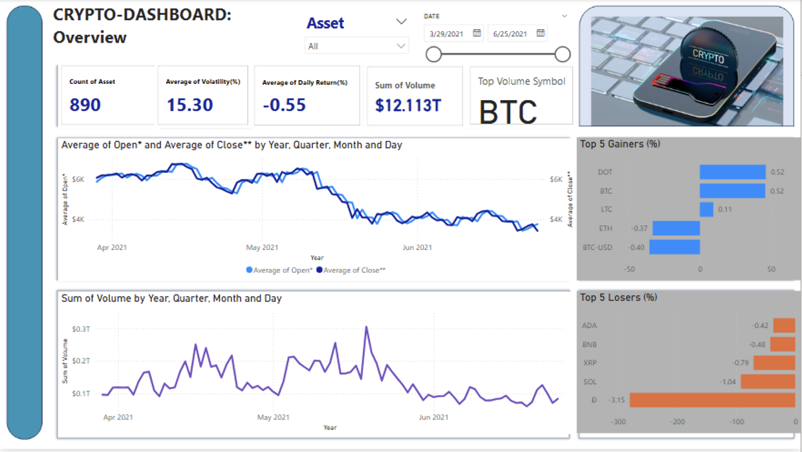
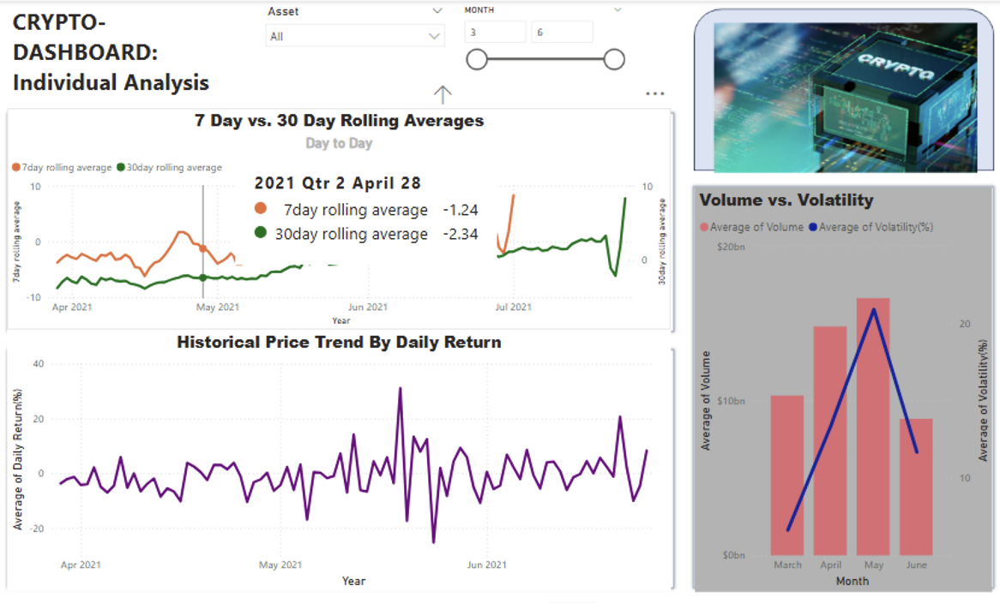
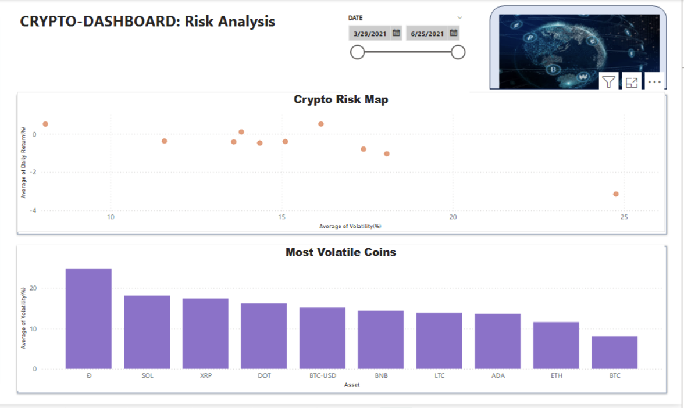
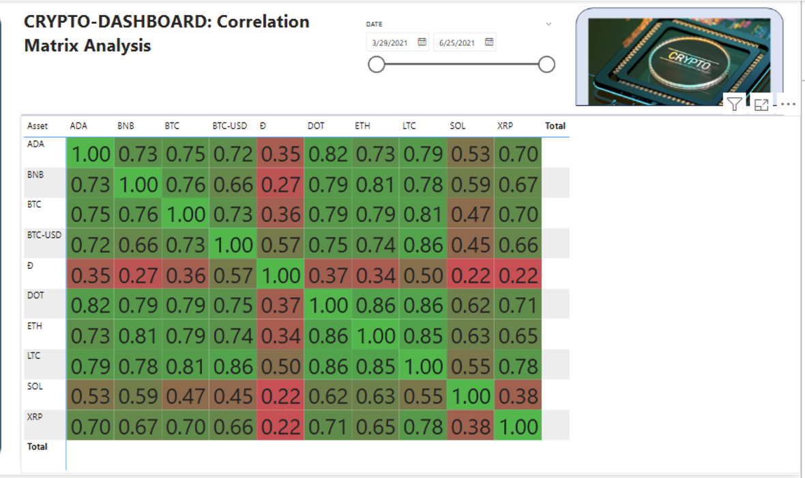

# Crypto Dashboard

An interactive Power BI dashboard for exploring cryptocurrency market behavior from **March 29, 2021 to June 25, 2021**—including price trends, trading volume, volatility, daily returns, and how coins move in relation to one another.

> **File:** `CryptoDash.pbix` · **Tool:** Microsoft Power BI Desktop · **Report:** 5 pages (1280 × 720)



---

## Table of Contents

- [Overview](#overview)
- [Dashboard Pages](#dashboard-pages)
- [Data Model](#data-model)
- [Key Metrics](#key-metrics)
- [DAX Measures and Calculations](#dax-measures-and-calculations)
- [Key Insights](#key-insights)
- [Getting Started](#getting-started)
- [How to Use the Dashboard](#how-to-use-the-dashboard)
- [Project Structure](#project-structure)
- [Future Improvements](#future-improvements)
- [Author](#author)

---

## Overview

The dashboard tracks **10 assets** (ADA, BNB, BTC, BTC-USD, Ð, DOT, ETH, LTC, SOL, XRP) over **89 days**, with **890 daily records** altogether. It helps answer questions such as:

- Which coins gained or lost the most, and which had the highest trading volume?
- How do short-term trends stack up against long-term ones?
- Which assets are most volatile, and does that risk come with higher returns?
- Which coins move in tandem, and which can offer diversification?

Every page includes date slicers and, where relevant, asset or month slicers. Shift from the market-wide view to one coin and a particular time window.

---

## Dashboard Pages

### 1. Overview
A market-wide snapshot of the selected assets and dates.


- **KPI cards:** asset count (890 records), average volatility (15.30%), average daily return (−0.55%), total volume ($12.113T), and top-volume symbol (BTC)
- **Open vs. Close** line chart, with year → quarter → month → day drill-down
- **Total Volume** trend over time
- **Top 5 Gainers (%)** and **Top 5 Losers (%)** bar charts
- **Asset** and **Date** slicers

### 2. Individual Analysis
A closer look at one cryptocurrency at a time.



- **7-Day vs. 30-Day Rolling Averages** compare short-term momentum with the longer trend; a tooltip shows day-level detail
- **Volume vs. Volatility** combo chart by month (volume columns and a volatility line)
- **Historical Price Trend by Daily Return**
- **Asset** and **Month** slicers

### 3. Comparative Analysis
Compare assets side by side.


- **Price Trend for Cryptocurrency** for BNB, BTC-USD, ETH, and SOL
- **Average Volatility and Average Volume by Asset** column chart
- **Volatility, Volume, and Performance Matrix** table showing volatility, total volume, and average daily return for each asset

### 4. Risk Analysis
See where risk sits in the market.



- **Crypto Risk Map:** A scatter plot of average volatility (%) against average daily return (%) for each asset.
- **Most Volatile Coins** ranking.
- **Date** slicer.

### 5. Correlation Matrix Analysis
See how assets move in relation to one another.



- An asset-by-asset **correlation coefficient matrix**, colored from green to red to show high-to-low correlation.
- **Date** slicer for viewing how correlations shift across periods.

---

## Data Model

| Table | Purpose |
|-------|---------|
| `Sheet1` | Main fact table: one row for each asset per day (890 rows) |
| `DateTable` | Calendar table with a date hierarchy, month, and rolling-average calculations |
| `Symbolist` / `Symbolist 2` | Asset lists used to build the Asset × Asset correlation matrix |

**Source data:** `merged_cryptocurrency_data.xlsx`. Daily historical data for 10 cryptocurrencies, with 89 days each (3/29/2021 – 6/25/2021), for 890 rows in total.

**Raw columns:** `Date`, `Open*`, `High`, `Low`, `Close**`, `Volume`, `Market Cap`, `Asset`

**Calculated in Power BI:** `Volatility(%)`, `Daily Return(%)`, `Price Change`, `Top Volume Symbol`

**Assets:** The source file uses full names; ticker-style labels appear on the dashboard.

| Dashboard label | Asset |
|-----------------|-------|
| ADA | Cardano |
| BNB | Binance Coin |
| BTC | Bitcoin |
| BTC-USD | Bitcoin Cash |
| Ð | Dogecoin |
| DOT | Polkadot |
| ETH | Ethereum |
| LTC | Litecoin |
| SOL | Solana |
| XRP | XRP |

---

## Key Metrics

| Metric | Description |
|--------|-------------|
| **Daily Return (%)** | Percentage change in price from one day to the next |
| **Volatility (%)** | Size of price swings; higher values mean greater risk |
| **Volume** | Total value traded, used as a proxy for market activity and liquidity |
| **Price Change** | Difference between the closing and opening price |
| **Top Volume Symbol** | Asset with the highest trading volume under the current filters |
| **7-Day / 30-Day Rolling Average** | Moving averages that smooth daily noise and reveal trend direction |
| **Correlation Coefficient** | Ranges from −1 to +1; measures how closely two assets move together |

---

## DAX Measures and Calculations

Calculated fields in the model include:

- **7day rolling average** and **30day rolling average** (`DateTable`)
- **Top Volume Symbol** (`Sheet1`)
- **Correlation Coeff** (`Symbolist`)

_Replace the example below with your actual DAX:_

```dax
7day rolling average =
AVERAGEX(
    DATESINPERIOD(DateTable[DATE], MAX(DateTable[DATE]), -7, DAY),
    CALCULATE(AVERAGE(Sheet1[Daily Return(%)]))
)
```

---

## Key Insights

Findings for **3/29/2021 – 6/25/2021**:

- **

  ---

## Getting Started

### Prerequisites
- [Power BI Desktop](https://powerbi.microsoft.com/desktop/) (free, Windows)

### Run Locally
1. Clone or download this repository.
2. Open `CryptoDash.pbix` in Power BI Desktop.
3. If prompted, change the data source path under **Home → Transform data → Data source settings**.
4. Select **Refresh** to reload the data.

---

## Using the Dashboard

1. Switch between the five pages with the page tabs.
2. Use the **Asset slicer** to focus on one or more coins.
3. Narrow the time window with the **Date slicer** (or the **Month slicer** on Individual Analysis).
4. On line charts, use the **drill-down arrows** to move between year, quarter, month, and day.
5. **Click a bar or point** in any chart to cross-filter the other visuals on that page.

---

## Project Structure

```
CryptoDash/
├── CryptoDash.pbix        # Power BI report
├── README.md
└── screenshots/
    ├── overview.png
    ├── individual-analysis.png
    ├── comparative-analysis.png
    ├── risk-analysis.png
    └── correlation-matrix.png
```

---

## Future Improvements

- Connect to a live crypto API for automatic refresh
- Extend the date range beyond Q2 2021
- Add price and volatility forecasting
- Add a portfolio view with weighted returns
- Publish to Power BI Service and share a public report link

---

## Author

**Kwame Opoku-Afriyie**  
[GitHub](https://github.com/Chalcolite) · [LinkedIn](https://www.linkedin.com/in/kwameopoku-afriyie/)
